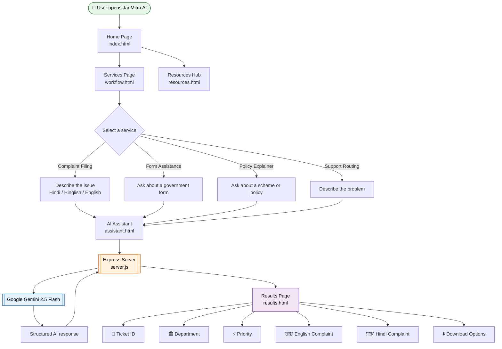
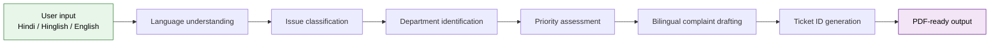
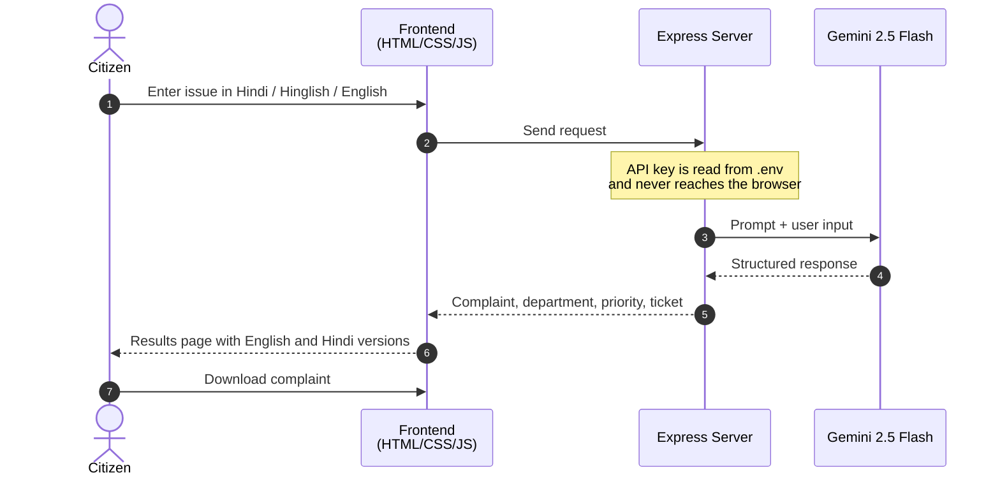
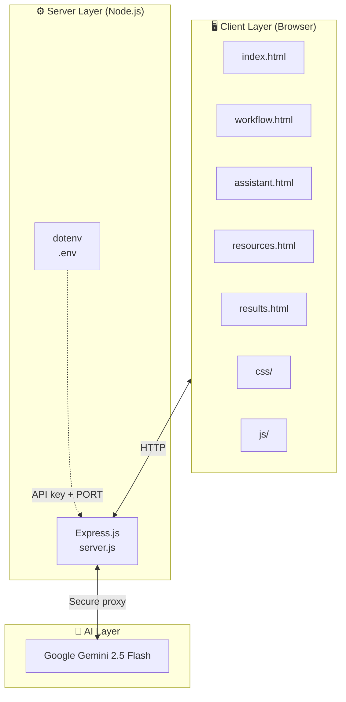
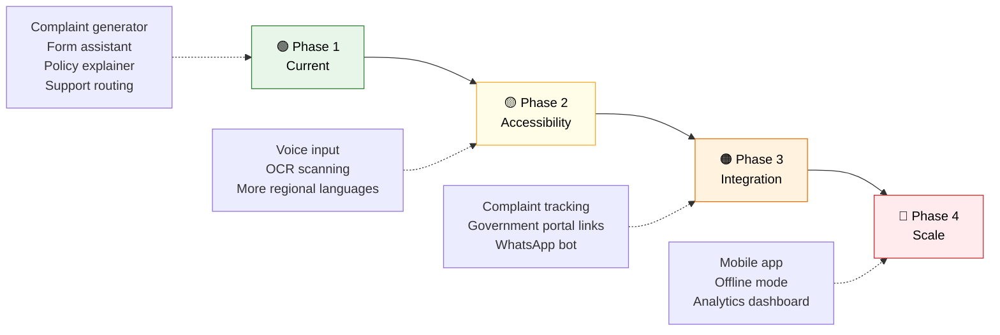

<div align="center">

# 🤝 JanMitra AI 🇮🇳

### AI-Powered Multilingual Citizen Services Platform

*🗣️ Speak in Hindi, Hinglish or English, and get 📝 professional bilingual complaints, 📋 form guidance and 📚 policy explanations in seconds.*

**Jan** (people) + **Mitra** (friend) = *a friend of every citizen.*


</div>

---

## 📖 Table of Contents

- [About the Project](#-about-the-project)
- [Key Features](#-key-features)
- [Target Users](#-target-users)
- [System Workflow](#-system-workflow)
- [Architecture](#-architecture)
- [Tech Stack](#-tech-stack)
- [Project Structure](#-project-structure)
- [Getting Started](#-getting-started)
- [Application Pages](#-application-pages)
- [Security](#-security)
- [Use Cases](#-use-cases)
- [Future Scope](#-future-scope)
- [Contributing](#-contributing)
- [License](#-license)

---

## 🎯 About the Project

Many citizens struggle to interact with government services. The language is formal, the forms are confusing, and it is rarely clear which department to approach. **JanMitra AI** closes that gap.

Powered by **Google Gemini AI**, the platform understands everyday input in **Hindi, Hinglish and English** and turns it into professional, structured, bilingual output that is ready to submit.

| Problem | How JanMitra AI helps |
|---|---|
| Hard to write a formal complaint | Generates a professional bilingual complaint from plain language |
| Confusing government forms | Gives step-by-step guidance and a document checklist |
| Policies are full of jargon | Explains schemes in simple language |
| Unsure which department to contact | Detects the issue type and routes it to the correct department |

---

## ✨ Key Features

### 📝 Complaint Generator
Generate professional bilingual complaints using AI.
- Hindi, Hinglish and English input
- Automatic department identification
- Complaint categorization and priority assessment
- Unique ticket ID generation
- PDF-ready complaint format

### 📋 Government Form Assistant
- Step-by-step form-filling guidance
- Document checklist support
- Simplified explanations
- Multilingual assistance

### 📚 Policy Explainer
- Scheme explanations
- Eligibility guidance
- Benefit descriptions
- Simple-language summaries

### 🧭 Support Routing
- Department detection
- Issue classification
- Government routing recommendations

### 🗂️ Resources Hub
- Government schemes and student resources
- FAQs and helplines
- Documentation and user guides

---

## 👥 Target Users

JanMitra AI is built for people who find official language, paperwork and process hard to navigate.

| 👤 User Group | 😟 Challenge They Face | ✅ How JanMitra AI Helps |
|---|---|---|
| 🏘️ **Citizens in towns and villages** | Comfortable in Hindi or Hinglish, but complaints must be in formal language | Turns plain, spoken-style input into a formal bilingual complaint |
| 🎓 **Students** | Scholarship, admission and certificate forms are confusing | Gives step-by-step form guidance and document checklists |
| 👵 **Senior citizens** | Pension and welfare scheme details are hard to find and understand | Explains schemes and eligibility in simple language |
| 👩‍💼 **First-time applicants** | Don't know which department handles their issue | Detects the issue type and routes it to the right department |
| 🏢 **Small businesses and shop owners** | Local grievances and licence queries take time to draft | Produces a ready-to-submit complaint draft with a ticket ID |
| 🤲 **NGOs and community volunteers** | Helping many people file complaints and applications | Speeds up drafting and keeps the format consistent |

---

## 🔄 System Workflow

### End-to-end user flow



### Complaint generation pipeline



### Request / response sequence



---

## 🏗️ Architecture



---

## 🛠️ Tech Stack

| Layer | Technology | Purpose |
|---|---|---|
| **Frontend** | HTML5 | Page structure and semantics |
| | CSS3 | Styling and responsive layout (one stylesheet per page) |
| | JavaScript | Client-side logic and API calls |
| **Backend** | Node.js | Server runtime |
| | Express.js | Web server and API proxy |
| **AI** | Google Gemini 2.5 Flash | Language understanding and generation |
| **Configuration** | dotenv | Environment variable management |

---

## 📁 Project Structure

```
JanMitra-AI/
│
├── index.html           # Landing page
├── workflow.html        # Services selection page
├── assistant.html       # AI assistant interface
├── resources.html       # Resources hub
├── results.html         # Generated complaint results
│
├── css/
│   ├── style.css
│   ├── home.css
│   ├── assistant.css
│   ├── workflow.css
│   ├── resources.css
│   └── results.css
│
├── js/                  # Client-side scripts
│
├── server.js            # Express server and Gemini proxy
├── package.json         # Node.js dependencies and scripts
├── requirements.txt
├── .env                 # API key and port (not committed)
├── .gitignore
│
└── assets/
```

---

## 🚀 Getting Started

### Prerequisites

- [Node.js](https://nodejs.org/) (v18 or later recommended)
- A [Google Gemini API key](https://aistudio.google.com/app/apikey)

### Installation

**1. Clone the repository**

```bash
git clone https://github.com/aasthapandya04/janmitrai-multilingual-assistant.git
cd janmitrai-multilingual-assistant
```

**2. Install dependencies**

```bash
npm install
```

**3. Configure environment variables**

Create a `.env` file in the project root:

```env
GEMINI_API_KEY=your_google_gemini_api_key
PORT=3000
```

**4. Start the server**

```bash
npm start
```

**5. Open in your browser**

```
http://localhost:3000
```

---

## 📄 Application Pages

| Page | File | Description |
|---|---|---|
| 🏠 **Home** | `index.html` | Landing page introducing JanMitra AI and its capabilities |
| 🧩 **Services** | `workflow.html` | Choose between Complaint Filing, Form Assistance, Policy Explainer and Support Routing |
| 🤖 **AI Assistant** | `assistant.html` | Interactive Gemini-powered assistant for citizen support |
| 📚 **Resources Hub** | `resources.html` | Government schemes, FAQs, guides and documentation |
| ✅ **Results** | `results.html` | Ticket ID, department, priority, English and Hindi complaint, and download options |

---

## 🔐 Security

- The Gemini API key is stored on the backend only
- All AI requests are routed through the Express proxy
- No API keys are exposed in the browser
- Environment variables are managed with `dotenv`
- `.env` is excluded from version control via `.gitignore`

---

## 💡 Use Cases

- Citizen grievance filing
- Government service guidance
- Scheme awareness
- Educational assistance for students
- Department routing
- Public service accessibility

---

## 🔮 Future Scope

JanMitra AI can grow from a complaint-drafting tool into a complete citizen-service companion. The roadmap below is a proposed direction.



### 🎙️ Phase 2: Accessibility
- [ ] **Voice-based complaint filing**: speak the issue instead of typing it
- [ ] **OCR document scanning**: upload a form, notice or ID and get it explained
- [ ] **Expanded regional language support**: Marathi, Bengali, Tamil, Telugu, Gujarati and more
- [ ] **Text-to-speech output**: read results aloud for users with low literacy or low vision

### 🔗 Phase 3: Integration
- [ ] **Complaint tracking dashboard**: follow the status of every ticket
- [ ] **Government portal integration**: submit complaints to official portals directly
- [ ] **WhatsApp integration**: file and track complaints in a chat app people already use
- [ ] **Email and SMS notifications**: status updates for each ticket

### 🚀 Phase 4: Scale
- [ ] **Mobile application** for Android and iOS
- [ ] **Offline-friendly mode** for areas with poor connectivity
- [ ] **User accounts and complaint history**
- [ ] **Analytics dashboard**: show departments and administrators which issues are most common
- [ ] **Admin panel** for managing schemes, FAQs and resources

---

## 🤝 Contributing

Contributions are welcome.

1. 🍴 Fork the repository
2. 🌿 Create a feature branch: `git checkout -b feature/your-feature`
3. 💾 Commit your changes: `git commit -m "Add your feature"`
4. 📤 Push to the branch: `git push origin feature/your-feature`
5. 🔁 Open a Pull Request

---

## 📜 License

This project is developed for educational, innovation and hackathon purposes.

---

## 👥 Team

Developed as part of an AI-driven citizen service initiative to improve accessibility, transparency and efficiency in government interactions.

<div align="center">

**Made with ❤️ for Bharat 🇮🇳**

</div>
